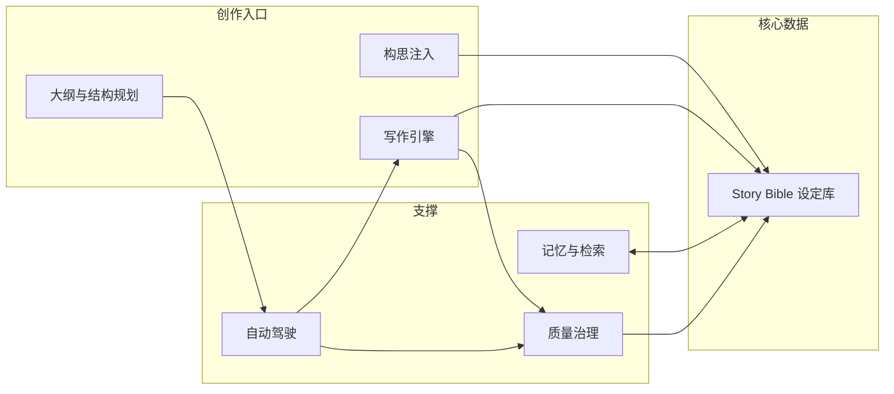

# 灵墨（Lingmo）— 产品需求文档（PRD）

> **文档状态：基准（Spec）** — 定义产品应有的样子，不记载实现进度。进度、阶段划分与验收状态一律看 [04-开发路线图.md](04-开发路线图.md)。

## 需求背景

作者（本项目唯一用户）在用 AI 辅助写网络小说时，遇到两类互相矛盾的工具：一类是「自动驾驶」型（如 PlotPilot），能维持长篇一致性、管好世界观人物，但作者很难中途插入自己的构思，产出容易跑偏、AI 味重；另一类是「聊天」型（如 SillyTavern），人能主导、交互自然，但设定散落在对话里，几十万字后人物和伏笔全乱。

作者的真实诉求是：**既要自动驾驶的生产力，又要随时把自己的构思插进去**。本项目要解决的核心问题，就是让「作者的一句话构思」能被干净地翻译成「引擎能执行的结构化约束」，并沉淀进统一设定库。

## 需求目标

- 建立一个**唯一事实源的 Story Bible**，世界观、人物、地点、时间线、伏笔全部结构化存储，可随时增删改。
- 让作者能用**三种粒度**注入构思：结构化设定卡、章前指令、对话式自然语言。
- 提供**自动驾驶**能力：在作者定好的大纲与设定约束下自主推进多章，可随时暂停、注入、改向。
- 每次生成都做**一致性检查**，主动提示人设冲突、伏笔遗漏、文风漂移，而不是静默产出。

## 目标用户与使用场景

单用户（作者本人）。三种典型场景，按优先级排序：

1. **设定沉淀**（P0）：作者脑中已有的世界观/人物，逐条录入并建立关联，系统可视化呈现。
2. **人工主导写作**（P0）：作者一章章写或改，点击“定稿沉淀”后由系统抽取新设定建议，并提示与已有设定的冲突。
3. **自动驾驶 + 构思注入**（P1）：作者定好大纲，引擎自主推进；写到某处作者突发灵感，喊停并注入新构思，引擎据此调整后续。

## 总体产品结构

三条创作主线（人工主导 / 自动驾驶 / 对话共创）共用同一套 Story Bible，任意时刻切换不丢设定。

---

## 功能需求详述

### F1 项目管理

作者可创建、打开、删除「作品」。每个作品是一个独立的 Story Bible 实例，包含该作品全部设定与章节。

| 项 | 说明 |
|----|------|
| 触发 | 首次进入系统，或从作品列表点「新建」 |
| 处理 | 创建作品时要求填写：书名、题材/类型（玄幻/都市/言情/科幻等，可自定义）、一句话简介 |
| 结果 | 生成该作品专属的 Story Bible 初始骨架（空的世界观/人物/地点/时间线/伏笔），进入工作台 |
| 边界 | 删除作品需二次确认；删除不可恢复 |

### F2 Story Bible 设定库

设定库是系统地基，分六类实体，均支持增删改查，且实体之间可建立关联（如「人物 A 隶属 势力 B」「伏笔 X 关联 人物 C」）。这是**阶段一的全部交付内容**，数据模型详见 [03-数据模型.md](03-数据模型.md)。

| 实体 | 关键字段 | 说明 |
|------|----------|------|
| 世界观 | 名称、类型（法则/地理/势力/修炼体系等）、描述、三元组标签 | 世界运行规则与背景 |
| 人物 | 姓名、身份、性格、目标、外貌、口头禅、POV 视角、登场频率 | 人物档案，写作时注入上下文 |
| 地点 | 名称、层级、描述、关联事件 | 场景发生地 |
| 时间线 | 事件、时间点、参与者、因果关联 | 关键事件的时序登记 |
| 伏笔 | 状态（已埋/已悬置/已消费）、关联章节、提示内容 | 钩子的开启与闭合追踪 |
| 关系 | 主体、客体、关系类型、备注 | 人物/势力间关系 |

**设定面板交互**：左侧是六类实体的列表，右侧是详情编辑；另有一个「知识图谱」视图，用节点-连线展示实体间的关联，可点击节点直达编辑。

**触发 → 处理 → 结果**：作者新增/修改任一设定 → 系统保存并计算该设定与现有设定的冲突 → 若有冲突（如人物年龄与时间线矛盾）即时提示 → 设定落库后，后续章节生成都会自动注入相关设定。

### F3 大纲与结构规划

作者为作品规划层级结构：**卷 → 幕 → 章节**，每层可写概要。支持拖拽调整顺序、增删节点。

| 项 | 说明 |
|----|------|
| 触发 | 在「大纲」页操作 |
| 处理 | 作者可先手写大纲，也可让系统基于 Story Bible 生成「宏观规划建议」供参考 |
| 结果 | 大纲树作为自动驾驶的推进依据；每章写作前，系统从大纲取当前章的定位与目标注入上下文 |
| 边界 | 自动驾驶只在大纲存在时才可用 |

### F4 写作引擎

核心写作能力，分四种动作：**开新章**、**续写**、**改写**、**章前指令**。

| 动作 | 触发 | 处理 | 结果 |
|------|------|------|------|
| 开新章 | 点「写新章」 | 系统从 Story Bible + 大纲当前位置 + 摘要链装配上下文，调用 LLM 生成正文 | 生成章草稿，进入编辑区 |
| 续写 | 在章尾点「续写」 | 携带上文 + 相关设定 + 伏笔继续生成 | 追加正文 |
| 改写 | 选中段落点「改写」 | 可选改写意图（更细腻/更爽/去 AI 味/压缩） | 替换选中段落，保留其余 |
| 章前指令 | 写作前在指令框输入 | 指令作为**强约束**拼入 prompt（如「本章要让主角与 B 决裂」「埋下关于身世的伏笔」） | 生成内容优先满足指令 |

**编辑区**：作者可直接手改正文；修改本身不触发完整沉淀，作者确认内容后显式点击“定稿沉淀”（见 F6）。

### F5 构思注入（本项目差异化核心）

作者把构思喂给系统的三种通道，按结构化程度从高到低：

| 通道 | 触发 | 处理 | 结果 |
|------|------|------|------|
| 结构化设定卡 | 直接编辑 Story Bible | 落库为结构化实体 | 立即生效，影响后续所有生成 |
| 章前指令 | 写作前填指令框 | 作为强约束注入当前章 prompt | 仅影响当前章 |
| 对话式构思 | 在聊天框用自然语言描述（如「接下来让 X 黑化，因为他知道了身世」） | 系统做**意图识别**，抽取目标人物/事件/因果，转成设定变更建议，作者确认后落库并触发重新规划 | 更新 Story Bible + 调整后续大纲，形成「边聊边改」闭环 |

对话式构思是**阶段四**交付，前三个阶段先跑通前两种通道。

### F6 记忆与检索

解决「模型失忆」与「设定不沉淀」的问题。

| 子功能 | 处理 | 结果 |
|--------|------|------|
| 定稿沉淀 | 作者点击“定稿沉淀”后，触发摘要、设定建议、记忆写入、漂移检测和规则一致性检查；仅修改章节状态不触发完整沉淀 | 作者确认设定建议后才更新 Story Bible，设定持续累积 |
| 语义检索 | 写作时按当前场景语义，从向量库召回相关历史设定与章节片段 | 相关设定自动注入上下文 |
| 一致性提示 | 生成内容与 Story Bible 比对，检测到冲突时高亮提示 | 作者可见冲突，决定采纳生成 or 修正 |

### F7 质量治理

| 子功能 | 说明 |
|--------|------|
| 一致性检查 | 检测生成内容是否违反人设（性格/立场/已知信息）、时间线是否矛盾、已消费伏笔是否被重复使用 |
| 伏笔追踪 | 展示每个伏笔的「已埋/已悬置/已消费」状态，提示长期未闭合的伏笔 |
| 文风锚定 | 作者选定一段「风格基准」文本，后续生成计算与其的文风相似度，偏离过高时提示 |
| 去 AI 味 | 扫描高频套路表达（如「不禁」「仿佛」「一阵」滥用），标注并支持一键改写 |
| 张力评分 | 每章生成后给出 0–10 张力分，历史曲线可视化，低谷提示作者是否要加冲突 |

### F8 自动驾驶模式

| 项 | 说明 |
|----|------|
| 触发 | 作者在大纲就绪后点「开始自动驾驶」 |
| 处理 | 引擎按大纲顺序逐章推进：装配上下文 → 生成 → 质量检查 → 状态落库 → 进入下一章；章节失败连续超阈值时自动暂停并给出诊断 |
| 干预 | 作者可随时「暂停」，此时可通过 F5 任一通道注入构思，引擎据此**重新规划**后续章节后继续 |
| 结果 | 产出连续多章草稿，作者事后统一审校 |
| 边界 | 自动驾驶生成的章节默认标记为「草稿」；作者审校后须显式点击“定稿沉淀”才触发完整沉淀，仅把状态改为 `finalized` 不触发 |

### F9 导出

将作品章节导出为 TXT / Markdown / DOCX，支持整本或按卷导出。阶段二开始提供，MVP 阶段可先只做 Markdown。

---

## 非功能需求

- **本地优先**：数据全部存本机 SQLite，向量存本地，断网也可读写设定与已有章节；仅 LLM 生成需要网络。
- **成本可控**：默认走国产低价模型（DeepSeek），嵌入走本地模型，避免每章高额 API 费用。
- **响应**：设定面板增删改响应 ≤ 200ms；单章生成提供流式输出（SSE），边生成边显示。
- **单用户**：无需登录、权限、多租户。

## 范围外（明确不做）

- 多用户、账号体系、云端同步、对外部署。
- 移动端、桌面安装包（后续可评估，非本阶段）。
- 绘画/封面生成、语音朗读（后续可评估）。
