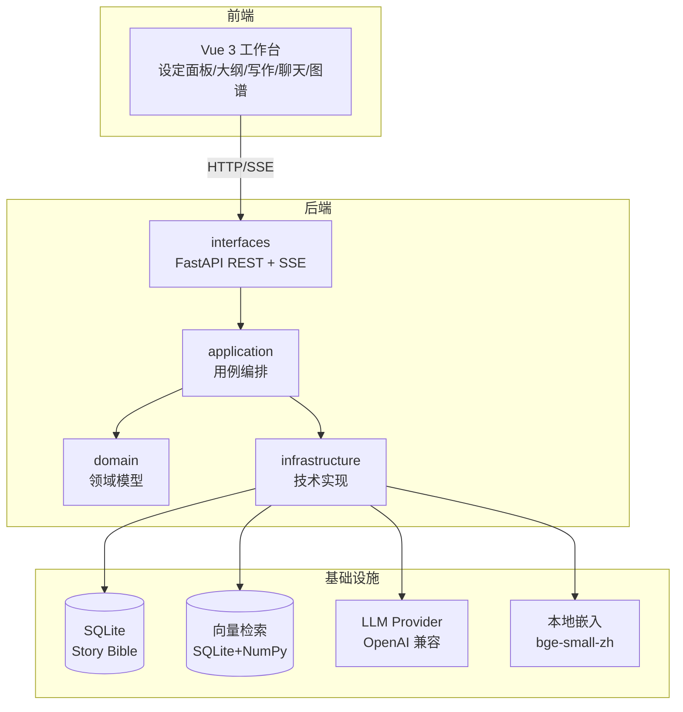
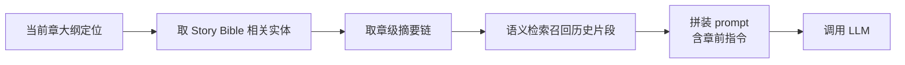
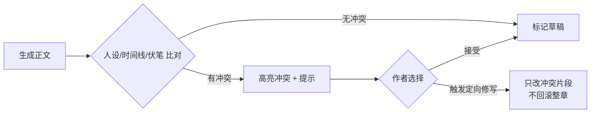
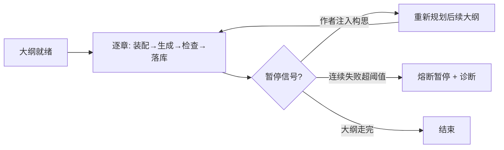

# 灵墨（Lingmo）— 技术架构设计

本文回答「怎么实现」。对应 PRD 的「what」，本文聚焦系统结构、模块边界、技术选型与关键流程。

## 总体架构

分层职责：

- `domain`：纯业务模型与值对象，不依赖任何框架。如 `Novel`、`Character`、`WorldSetting`、`Foreshadowing`、`Chapter`。
- `application`：用例编排，协调领域与基础设施。如「生成一章」「注入构思」「一致性检查」「自动沉淀」。
- `infrastructure`：技术实现，可替换。如 LLM Provider 适配、SQLite 仓储、向量检索（SQLite+NumPy）、嵌入服务。
- `interfaces`：FastAPI 路由与依赖注入，是唯一对外边界。

## 技术选型与理由

| 层 | 选型 | 理由 |
|----|------|------|
| 后端 | Python 3.11+、FastAPI、uvicorn | 异步 + 自动 OpenAPI + 原生 SSE 流式输出 |
| 主数据库 | SQLite | 单用户零部署、零配置，够用 |
| 向量检索 | SQLite 存向量 + NumPy 余弦相似度 | 单用户数据量小，免额外服务与重依赖；超约 5 万条再上 faiss-cpu / sqlite-vec |
| 嵌入 | 本地 `bge-small-zh-v1.5`（`fastembed`，ONNX） | 中文效果好、离线、零成本、无 PyTorch；可切云端 OpenAI 兼容嵌入 |
| LLM | OpenAI 兼容协议，默认 DeepSeek | 统一接口，切模型不改业务代码；国产低价模型省成本 |
| 前端 | Vue 3 + TS + Vite + Naive UI + ECharts | 与参考项目 PlotPilot 一致，图谱/DAG 用 ECharts |
| 依赖注入 | FastAPI `Depends` 或轻量容器 | 保持分层可测 |

## 模块划分

### 后端 domain 层（与数据模型一一对应）

`Novel`、`Character`、`Location`、`WorldSetting`、`TimelineEvent`、`Foreshadowing`、`Relationship`、`Chapter`、`OutlineNode`、`MemoryChunk`。字段详见 [03-数据模型.md](03-数据模型.md)。

### application 层用例（核心）

| 用例 | 职责 |
|------|------|
| `write_chapter` | 装配上下文 → 调 LLM → 落章草稿 |
| `continue_chapter` | 带上下文续写 |
| `rewrite_passage` | 带意图改写段落 |
| `inject_idea` | 三通道构思注入的统一入口 |
| `auto_pilot` | 大纲驱动多章推进，含熔断与暂停 |
| `consistency_check` | 生成内容 vs Story Bible 冲突检测 |
| `settle_chapter` | 定稿后自动沉淀设定（生成变更建议） |
| `build_context` | 从 Story Bible + 摘要链 + 检索装配上下文 |
| `score_tension` | 张力评分 |

### infrastructure 层

- `ai/`：`LLMProvider`（OpenAI 兼容客户端抽象）、`EmbeddingService`（本地/云端切换）、`PromptPackages`（集中管理 prompt）。
- `persistence/`：SQLite 仓储、迁移脚本、单写者调度。
- `vector/`：向量检索（SQLite 存向量 + NumPy 相似度）。**注意：本模块不在阶段三实现**，推迟到自动驾驶稳定后的「记忆与检索层」里程碑（届时随 `memory_chunk`/`injection` 一并落地）。
- `export/`：Markdown/DOCX 导出。

## 关键流程

### 1. 上下文装配（每章生成前）

装配内容按 token 预算截断，优先级：章前指令 > 大纲定位 > 直接相关设定 > 摘要链 > 语义召回片段。

### 2. 一致性检查（生成后）

检查手段分两档：规则库（人物已知信息、时间线先后、伏笔状态）+ LLM 语义判断（性格/立场是否跑偏）。阶段一先落规则库，LLM 判断后置。

### 3. 自动驾驶推进

### 4. 构思注入（统一入口）

三通道最终都归一为对 Story Bible 或大纲的「变更集」，差异只在解析方式：

- 结构化设定卡：直接写领域实体。
- 章前指令：写入当前章生成请求的强约束字段。
- 对话式构思（阶段四）：LLM 做意图识别 → 产出「设定变更建议」→ 作者确认 → 应用变更 + 触发大纲重规划。

## 流式输出与长任务

- 单章生成走 SSE，前端边收边渲染。
- 自动驾驶是长任务，用后台任务 + SSE 推送进度（当前阶段/token 消耗/章节号），前端可随时发「暂停」。

## 安全与边界

- LLM Key 只在 `.env` 配置，不进库、不进 git。
- 所有写 SQLite 走统一调度器，避免并发写冲突。
- 本地嵌入模型权重不提交 git，用下载脚本 + 缓存目录管理。
