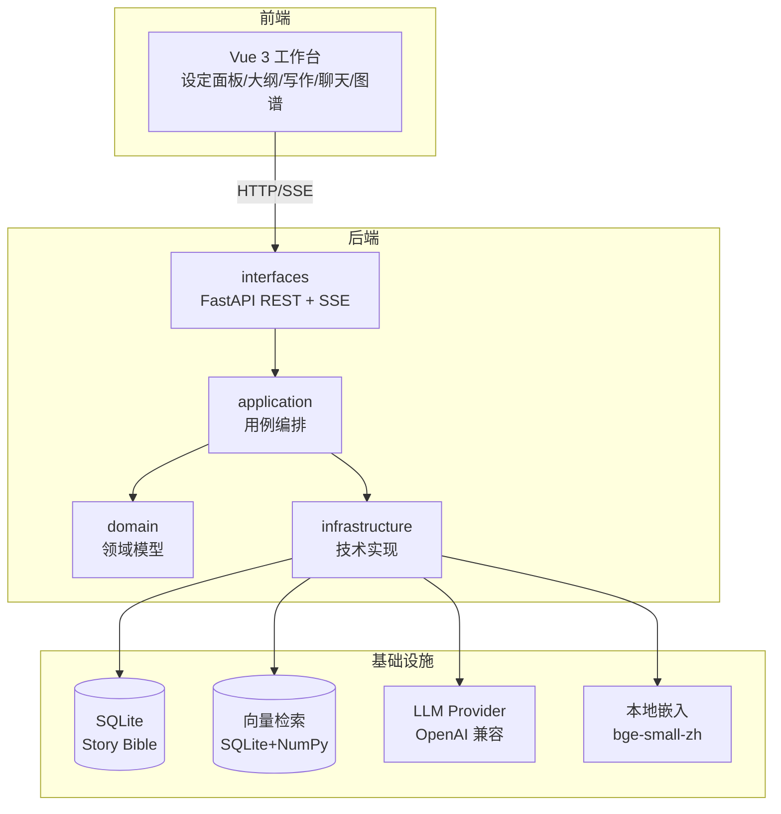
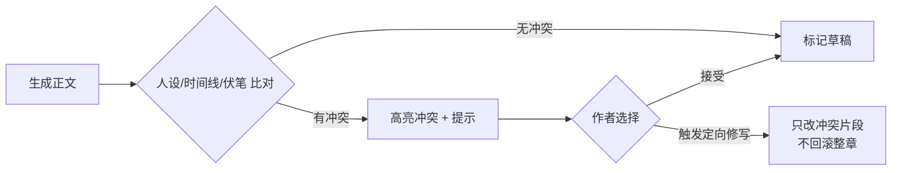
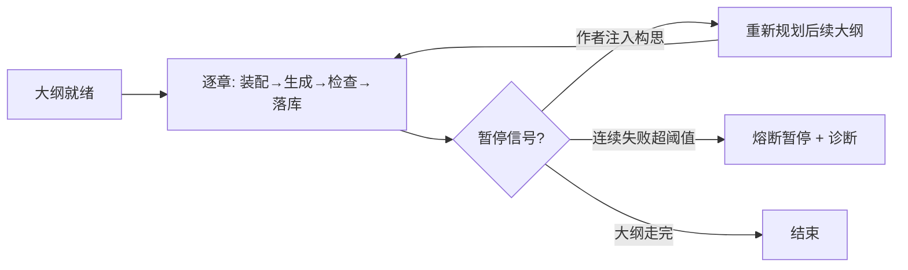

# 灵墨（Lingmo）— 技术架构设计

> **文档状态：基准（Spec）** — 定义系统应有的结构与技术选型，不记载实现进度。若与代码冲突，先查 [04-开发路线图.md](04-开发路线图.md) 的已收口状态与 `AGENTS.md` 的「当前状态」，确认是文档过时还是实现走偏，再决定改哪边。

本文回答「怎么实现」。对应 PRD 的「what」，本文聚焦系统结构、模块边界、技术选型与关键流程。

## 总体架构

分层职责：

- `domain`：纯业务模型与值对象，不依赖任何框架。如 `Novel`、`Character`、`WorldSetting`、`Foreshadowing`、`Chapter`。
- `application`：用例编排，协调领域与基础设施。如「生成一章」「注入构思」「一致性检查」「自动沉淀」。
- `infrastructure`：技术实现，可替换。如 LLM Provider 适配、SQLite 仓储、向量检索（SQLite+NumPy）、嵌入服务。
- `interfaces`：FastAPI 路由与依赖注入，是唯一对外边界。

## 技术选型与理由

| 层 | 选型 | 理由 |
|----|------|------|
| 后端 | Python 3.11+、FastAPI、uvicorn | 异步 + 自动 OpenAPI + 原生 SSE 流式输出 |
| 主数据库 | SQLite | 单用户零部署、零配置，够用 |
| 向量检索 | SQLite 存向量 + NumPy 余弦相似度 | 单用户数据量小，免额外服务与重依赖；超约 5 万条再上 faiss-cpu / sqlite-vec |
| 嵌入 | 本地 `bge-small-zh-v1.5`（`fastembed`，ONNX） | 中文效果好、离线、零成本、无 PyTorch；可切云端 OpenAI 兼容嵌入 |
| LLM | OpenAI 兼容协议，默认 DeepSeek | 统一接口，切模型不改业务代码；国产低价模型省成本 |
| 前端 | Vue 3 + TS + Vite + Naive UI + ECharts | 与参考项目 PlotPilot 一致，图谱/DAG 用 ECharts |
| 依赖注入 | FastAPI `Depends` 或轻量容器 | 保持分层可测 |

## 模块划分

### 后端 domain 层（与数据模型一一对应）

`Novel`、`Character`、`Location`、`WorldSetting`、`TimelineEvent`、`Foreshadowing`、`Relationship`、`Chapter`、`OutlineNode`、`MemoryChunk`。字段详见 [03-数据模型.md](03-数据模型.md)。

### application 层用例（核心）

| 用例 | 职责 |
|------|------|
| `write_chapter` | 装配上下文 → 调 LLM → 落章草稿 |
| `continue_chapter` | 带上下文续写 |
| `rewrite_passage` | 带意图改写段落 |
| `inject_idea` | 三通道构思注入的统一入口 |
| `auto_pilot` | 大纲驱动多章推进，含熔断与暂停 |
| `consistency_check` | 生成内容 vs Story Bible 冲突检测 |
| `settle_chapter` | 作者显式点击“定稿沉淀”后生成设定变更建议 |
| `delivery` | 全书统计、卷归属、导出范围解析与零模型调用的预检查 |
| `export` | 共用范围解析，生成 Markdown / TXT / DOCX |
| `build_context` | 从 Story Bible + 摘要链 + 检索装配上下文 |
| `score_tension` | 张力评分 |

### infrastructure 层

- `ai/`：`LLMProvider`（OpenAI 兼容客户端抽象）、`EmbeddingService`（本地/云端切换）、`PromptPackages`（集中管理 prompt）。
- `db.py` / `repository.py` / `models.py`：SQLAlchemy 引擎与会话、仓储、ORM 模型（20 张表，含 `chapter_revision`、`chapter_settle_receipt`、`chapter_creation_receipt`、`chat_action`、`autopilot_draft`、`autopilot_task`、`autopilot_task_event`）。**不存在 `persistence/` 子目录**，仓储即 `repository.py`。
- `vector/`：向量检索（`memory_chunk.vector` 存 JSON 数组 + NumPy 余弦相似度），已随「记忆与检索层」里程碑落地。
- 导出（Markdown / TXT / DOCX）实现在 `application/export.py`，统一复用 `application/delivery.py` 的范围解析；**不存在 `infrastructure/export/`**。DOCX 使用 `python-docx`。
- 章节目录提供独立 `/chapters/metadata` 列投影，完整正文按章读取，旧完整列表保持兼容。目录字数由当前 SQLite 连接上的确定性 Unicode 计数函数计算，不新增缓存列或回填旧库；前端保存目录元信息及当前章详情，输入时只重新计算当前章字数。
- 手工创建 HTTP 冻结可选请求 UUID，在短 SQLite 写事务内分配默认序号、创建章及持久创建记录。相同 UUID 与有效载荷只读返回当前章；作品、载荷冲突或原章删除明确拒绝，不重新创建。首次回应 201、重放 200，返回完整章及创建确认标志；提交后不再读库。共享仓储保留调用方事务，未把此锁扩展为所有生成路径的全局调度器。
- 前端将待核对创建的原请求及当前编辑稿分别保存在当前浏览器同源存储。刷新仅列出恢复入口，作者恢复后明确核对；回应确认之前不更换 UUID、不自动覆盖当前章。该缓存不属于 SQLite 数据库备份，存储失败保留当前页面稿件并提供复制入口。

## 关键流程

### 1. 上下文装配（每章生成前）

装配内容按 token 预算截断，优先级：章前指令 > 大纲定位 > 直接相关设定 > 摘要链 > 语义召回片段。

### 2. 一致性检查（生成后）

检查手段分两档：规则库（人物已知信息、时间线先后、伏笔状态）+ LLM 语义判断（性格/立场是否跑偏）。阶段一先落规则库，LLM 判断后置。

持续第九阶段的语义复核按实际完整验证成功计入 `chunks_checked`，分别返回尝试、失败、两类跳过、八块上限未查数量及 `complete/partial/failed/skipped` 状态；已有规则命中单独返回，不因语义过滤隐藏。模型输出必须是合法冲突数组，引文须实际位于当前分块，整块无效不冒充空结果成功。相关事实按本作品实体与明确引用装配为 JSON，保留同名实体、关系对端及关联事件/伏笔，不反解析展示文字。前端核验覆盖统计及回应结构，旧或异常合同不报通过，等待期间作者改稿则丢弃旧结果；全程只读，最多八次调用且不进入定稿主流程。

### 3. 自动驾驶推进

### 4. 构思注入（统一入口）

三通道最终都归一为对 Story Bible 或大纲的「变更集」，差异只在解析方式：

- 结构化设定卡：直接写领域实体。
- 章前指令：写入当前章生成请求的强约束字段。
- 对话式构思（阶段四）：LLM 做意图识别 → 产出「设定变更建议」→ 作者确认 → 应用变更 + 触发大纲重规划。

## 流式输出与长任务

- 单章生成走 SSE，前端边收边渲染。
- 自动驾驶是长任务，用后台任务 + SSE 推送进度（当前阶段/token 消耗/章节号），前端可随时发「暂停」。
- 后台任务、快照和事件游标持久化；页面刷新或切换只影响订阅，不自动创建第二个任务。进程重启把未完成任务恢复为中断状态，保留可找回的半稿，不静默续跑。
- 作者显式设置的篇幅范围随任务冻结；完整保存后做确定性字数检查和剧情复核，越界或未完成核对会保留警告并暂停后续章节。修订候选先只读预览，作者确认保存才建立旧版本并按同范围复检。

## 安全与边界

- LLM Key 只在 `.env` 配置，不进库、不进 git。
- SQLite 写入使用事务；自动任务、草稿和章节覆盖路径另有串行写锁及条件更新，避免迟到请求覆盖。当前并未实现一个覆盖所有 CRUD 的独立全局写入调度器。
- 本地嵌入模型权重不提交 git，用下载脚本 + 缓存目录管理。
- 设定关联写入校验存在性与作品归属，地点父链/事件因果链不得成环；实体更新与旧索引失效保持同事务。重复定稿原子替换同章记忆，嵌入失败仍清理旧稿切片。
- 定稿提炼先核对页面冻结的作者字段，模型等待后再核对实际来源。建议确认必须提交该原稿指纹，逐项事务保存实体、索引和持久确认记录；相同建议重试返回已有结果，来源变化只允许回放已提交项，拒绝新增旧稿建议。已删除目标不因重试复活，名称冲突不隐式合并。
- 统一检查使用临时数据库和禁外呼环境；一致性备份使用 SQLite online backup，源库显式指定且只读，目标完整性校验通过后才报告成功。
