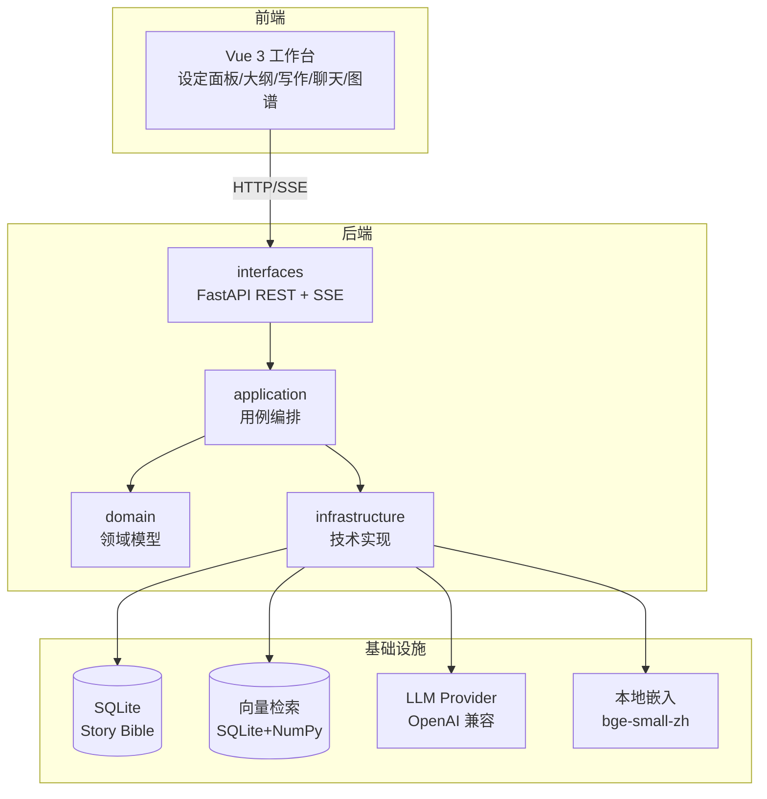
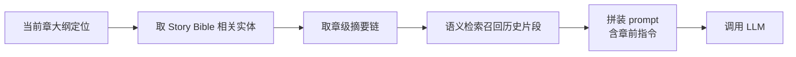
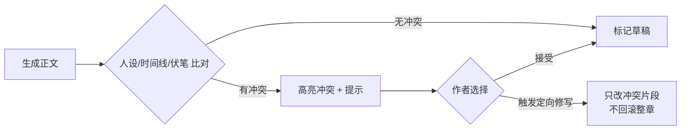
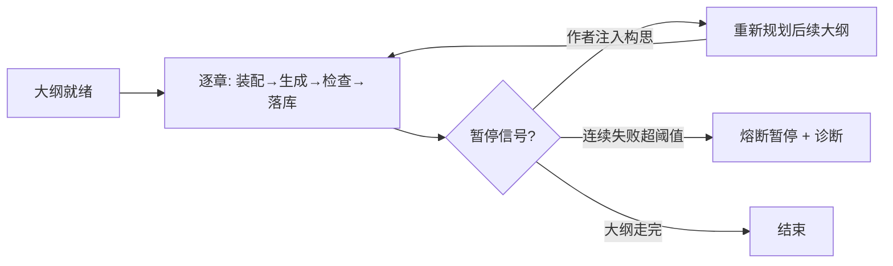

# 灵墨（Lingmo）— 技术架构设计

> **文档状态：基准（Spec）** — 定义系统应有的结构与技术选型，不记载实现进度。若与代码冲突，先查 [04-开发路线图.md](04-开发路线图.md) 的已收口状态与 `AGENTS.md` 的「当前状态」，确认是文档过时还是实现走偏，再决定改哪边。

本文回答「怎么实现」。对应 PRD 的「what」，本文聚焦系统结构、模块边界、技术选型与关键流程。

## 总体架构

分层职责：

- `domain`：纯业务模型与值对象，不依赖任何框架。如 `Novel`、`Character`、`WorldSetting`、`Foreshadowing`、`Chapter`。
- `application`：用例编排，协调领域与基础设施。如「生成一章」「注入构思」「一致性检查」「自动沉淀」。
- `infrastructure`：技术实现，可替换。如 LLM Provider 适配、SQLite 仓储、向量检索（SQLite+NumPy）、嵌入服务。
- `interfaces`：FastAPI 路由与依赖注入，是唯一对外边界。

## 技术选型与理由

| 层 | 选型 | 理由 |
|----|------|------|
| 后端 | Python 3.11+、FastAPI、uvicorn | 异步 + 自动 OpenAPI + 原生 SSE 流式输出 |
| 主数据库 | SQLite | 单用户零部署、零配置，够用 |
| 向量检索 | SQLite 存向量 + NumPy 余弦相似度 | 单用户数据量小，免额外服务与重依赖；超约 5 万条再上 faiss-cpu / sqlite-vec |
| 嵌入 | 本地 `bge-small-zh-v1.5`（`fastembed`，ONNX） | 中文效果好、离线、零成本、无 PyTorch；可切云端 OpenAI 兼容嵌入 |
| LLM | OpenAI 兼容协议，默认 DeepSeek | 统一接口，切模型不改业务代码；国产低价模型省成本 |
| 前端 | Vue 3 + TS + Vite + Naive UI + ECharts | 与参考项目 PlotPilot 一致，图谱/DAG 用 ECharts |
| 依赖注入 | FastAPI `Depends` 或轻量容器 | 保持分层可测 |

## 模块划分

### 后端 domain 层（与数据模型一一对应）

`Novel`、`Character`、`Location`、`WorldSetting`、`TimelineEvent`、`Foreshadowing`、`Relationship`、`Chapter`、`OutlineNode`、`MemoryChunk`。字段详见 [03-数据模型.md](03-数据模型.md)。

### application 层用例（核心）

| 用例 | 职责 |
|------|------|
| `write_chapter` | 装配上下文 → 调 LLM → 落章草稿 |
| `continue_chapter` | 带上下文续写 |
| `rewrite_passage` | 带意图改写段落 |
| `inject_idea` | 三通道构思注入的统一入口 |
| `auto_pilot` | 大纲驱动多章推进，含熔断与暂停 |
| `consistency_check` | 生成内容 vs Story Bible 冲突检测 |
| `settle_chapter` | 作者显式点击“定稿沉淀”后生成设定变更建议 |
| `delivery` | 全书统计、卷归属、导出范围解析与零模型调用的预检查 |
| `export` | 共用范围解析，生成 Markdown / TXT / DOCX |
| `build_context` | 从 Story Bible + 摘要链 + 检索装配上下文 |
| `score_tension` | 张力评分 |

### infrastructure 层

- `ai/`：`LLMProvider`（OpenAI 兼容客户端抽象）、`EmbeddingService`（本地/云端切换）、`PromptPackages`（集中管理 prompt）。
- `db.py` / `repository.py` / `models.py`：SQLAlchemy 引擎与会话、仓储、ORM 模型（20 张表，含 `chapter_revision`、`chapter_settle_receipt`、`chapter_creation_receipt`、`chat_action`、`autopilot_draft`、`autopilot_task`、`autopilot_task_event`）。**不存在 `persistence/` 子目录**，仓储即 `repository.py`。
- `vector/`：向量检索（`memory_chunk.vector` 存 JSON 数组 + NumPy 余弦相似度），已随「记忆与检索层」里程碑落地。
- 导出（Markdown / TXT / DOCX）实现在 `application/export.py`，统一复用 `application/delivery.py` 的范围解析；**不存在 `infrastructure/export/`**。DOCX 使用 `python-docx`。
- 章节目录提供独立 `/chapters/metadata` 列投影，完整正文按章读取，旧完整列表保持兼容。目录字数由当前 SQLite 连接上的确定性 Unicode 计数函数计算，不新增缓存列或回填旧库；前端保存目录元信息及当前章详情，输入时只重新计算当前章字数。
- 质量曲线读取 seq/title/status/两项评分共五列；伏笔聚合读取 id/seq/与 `bool((content or '').strip())` 等价的确定性 SQLite 回调结果共三列；交付目录读取八列并复用 Unicode 字数回调。不装载章节 ORM、摘要、章前指令或时间戳，正文仍由 SQLite 内部读取计算；完整列表、详情、预检与导出保持原实现。统计查询不提交或回滚调用方事务，保留默认隐式 autoflush 及调用方明确的 no_autoflush 行为。
- 自动驾驶作者输入修订和按作品/任务/请求 UUID 分开的提交状态位于 SFC 页面模块，setup 生命周期只拥有当前监控。同任务 pending/unknown 禁重复；确认匹配原 UUID、精确 UTF-8 原文及 SHA256、作品/任务和完整接收合同，旧回执游标可以小于当前进度，不能回写当前暂停、运行或事件游标。旧实例、作者新编辑、任务/作品 ABA 不允许旧回应清输入。未提交构思仍为页面内保护；待核对原请求与等待期间的新稿保存到浏览器同源 localStorage，刷新只列入口，不自动恢复、核对或重发。未恢复缓存与当前新输入分开，确认后尚未恢复稿继续保留；明确恢复时保护作者修订及任务身份。
- 可选 request_id 构思注入复用 autopilot_task_event 的 JSON 保存 UUID、原文、指纹与 accepted-only 回执，不新增表或队列。任务专用会话的短 BEGIN IMMEDIATE 覆盖查重、事件和快照游标提交，拒绝提交或回滚调用方已有章节修改；成功后不再查询数据库。相同 UUID 和载荷返回原回执，跨有效任务/作品或不同原文返回冲突；查询先校验原作品/任务，避免泄露其他作品原文。GET tasks/{task}/injections/{request} 只读核对，已消费、被新构思替换、任务结束、服务关闭或重启后均不重新安装指令。记录与内存派发之间崩溃时仍只证明已记录，启动保持 interrupted，不重建待用队列。旧 directive-only 接口兼容。
- 普通任务状态不冒充构思回执；只有精确原请求 not-found 查询才提供同 UUID、同原文的作者明确重试。未知核对不阻断暂停、恢复或新任务；缓存损坏或配额失败保留页内原文并提供复制提示，不假称已保存。localStorage 不包含在 SQLite 备份中，清理浏览器数据、换浏览器或换源无法找回；独立页签不共享实时提交锁。
- 伏笔追踪将当前作品的章节元信息与聚合结果原子采用；来源、读取序号及作者选章修订独立保护。按作品/伏笔的在途写锁、完成版本及未知回执状态在页面模块内跨组件挂载保留，读取冻结开始时的完成版本，提交前旧快照不能解除操作门禁。合法完整保存先采用真实作者字段，后置统计刷新失败不恢复旧消费按钮；卸载或作品往返的旧回应不投影到新界面。该状态不跨完整页面重载或独立页签持久化，不替代后端多写者保护。
- 设定编辑使用已有部分字段 PUT，只发送相对有效表单基线实际变化字段；JSON 对象按值比较、数组保留顺序，清空采用字段的真实空值。保存期间新编辑使完整回显失效，只推进已发送字段基线，未编辑旧字段不因服务端返回新事实而成为下次写入。创建仍完整提交，不新增同字段 CAS 或 JSON 内部合并。
- 手工创建 HTTP 冻结可选请求 UUID，在短 SQLite 写事务内分配默认序号、创建章及持久创建记录。相同 UUID 与有效载荷只读返回当前章；作品、载荷冲突或原章删除明确拒绝，不重新创建。首次回应 201、重放 200，返回完整章及创建确认标志；提交后不再读库。共享仓储保留调用方事务，未把此锁扩展为所有生成路径的全局调度器。
- 前端将待核对创建的原请求及当前编辑稿分别保存在当前浏览器同源存储。刷新仅列出恢复入口，作者恢复后明确核对；回应确认之前不更换 UUID、不自动覆盖当前章。该缓存不属于 SQLite 数据库备份，存储失败保留当前页面稿件并提供复制入口。
- 段落改写预览携带完整作者源字段与 Unicode 码点选区；前端由 DOM UTF-16 位置转换，后端核对精确原片段后按前缀、候选、后缀拼接。旧无选区预览只接受唯一匹配，重复片段不猜第一处；旧直接改写保持兼容。应用 `rewrite_apply` 必须提供完整原标题、正文、章前指令，复用章节版本短事务比较真实源并原子留档、更新和派生失效，旧稿返回 409。前端核验完整 done 合同和来源，冲突保留可复制候选，明确重读保护作者修订；普通手动保存合同不变，页面候选不跨完整重载持久化。
- 聊天可选规范 UUID 直接作为原用户消息主键，不新增表或列。请求专用短 SQLite 写事务原子查重、存精确原文及首次命名；提交后先返回 `user_saved`，后续历史/上下文读取属于生成阶段。GET `conversations/{id}/messages/requests/{request}` 以真实列核对原用户消息，只证明保存；同 UUID 同会话原文重放仅返回独立终态 `receipt`、`reply_restarted:false`，不重新调用模型。冲突不泄露其他会话原文，真正缺失与会话删除区分。共享消息仓储冻结六列，提交后返回原 ORM 身份而不 refresh；助手提交后的 done 使用冻结 ID/标题，无后置 SQL。
- 聊天页模块按会话/绑定保存精确原提交、新输入、作者修订与独立操作身份。历史刷新不删除原稿；旧 done、finally、跨会话或卸载不能清新发送及片段。明确 GET 核对与精确缺失后的原 UUID 重试均不清新输入；恢复、移除本地原稿与删除需要对应明确确认，作者修订和生命周期变化取消旧恢复。原稿、空白输入、在途或未知发送、未处理回复纳入导航与 beforeunload；这份状态不跨完整重载或其他页签持久化，不提供助手续接队列。
- 聊天模型上下文通过 ORM 两列查询读取最近二十条 `role/content`，章节摘要链读取最近三章 `seq/summary`；SQLite 同时间戳或序号以原 `rowid` 顺序稳定截取，再按原升序装配。先取三章再跳过空摘要，不补更早章；Story Bible 顺序、预算与完整消息/章节 API 不变。默认 autoflush 保留；显式禁用 flush 时返回当前数据库事务的真实列，不叠加 ORM 缓存未保存值，也不提交、回滚或丢弃调用方修改。完整 ORM 接口保留其原缓存语义。
- 会话选择先恢复、会话目录后到时，当前会话从目录未允许变为允许会补一次只读历史读取；合法目录常规更新不重复读取，在途发送不因资格到达被刷新。历史、原稿确认与新输入相互独立，明确删除仍清理对应页面记录。
- `GET conversations/{id}/messages/window` 返回最近完整消息窗口（默认 50、上限 100），通过同会话真实 `before_message_id` 回读时间戳/rowid 严格向前分页，游标可以是用户或助手消息。返回所属作品/会话、六列 items、has_more 与 next_before_message_id；旧全量 GET 保留。只读列查询不装载消息 ORM 实体，保留默认 autoflush 和显式禁 flush 的事务合同，不自行提交或回滚。
- `POST conversations/{id}/messages/actions/batch` 是只读批量查询，接受 1～100 个不重复的助手消息身份；整体校验同会话，非法来源不返回部分结果。每个请求身份都有显式动作数组，保持原五个动作字段及完整 JSON 摘要，作品内大纲/章节目标分别一次 IN 查询；最多五次 SELECT。全局会话新批量返回空数组，旧逐消息接口仍返回其原未绑定 400。
- 聊天页分别保护最新窗口、更早页与每条动作读取的身份和生命周期，按服务端顺序合并，不以 UUID 排并列消息；已加载旧页与原稿、新输入分开。明确加载更早保留可见旧锚点，动作标签后置高度变化再核对；读取失败不冒充无动作，不允许未知状态重复落地。真实消息元信息回包更新父缓存并使旧窗口失效，明确动作确认留在父缓存，再仅核对对应身份，重挂不因读回失败丢确认标签。这些缓存为页面运行期快照，完整重载重新读取最近窗口，不跨独立页签实时共享。
- 生成新章用例拥有干净请求会话，入口及最终写前拒绝调用方 new/dirty/deleted/flushed/Core 未提交写入，拒绝时不 flush/commit/rollback。实际最新章身份/序号与默认下一序号在模型前捕获，模型后仅最终短 SQLite BEGIN IMMEDIATE 内重读核对；同消息既有动作先回真实原章，否则章与 chat_action 同事务保存。第二十阶段另捕获真正拼入提示的前章 novel/id/title/content/directive 原值，标题/正文直接由冻结值装配；最终写锁内以真实 Core 三列核对其作品与身份，改变或不存在拒绝落章。大纲筛选的实际前章可能并非最新章；未使用章或仅摘要、状态、评分、时间戳变化不触发这项作者字段冲突。已存同助手回执仍先返回，不因前章后来改变或删除而重建。提交前冻结完整返回，提交后无 refresh/SQL。冲突 SSE 保既有 token 并返回 chapter_write_conflict/status409/saved:false/hint；存储异常使用固定安全提示。普通显式同序号和自动驾驶显式序号合同不改；前章三作者字段保护不代表全 Story Bible 或整个历史上下文 CAS。
- 全局会话升级使用独立干净请求会话，在短 SQLite BEGIN IMMEDIATE 内读取真实绑定，创建作品和更新会话一次提交；已绑定/缺失拒绝零建书，异常整组回滚。入口拒绝调用方未提交 DML 时零 flush/commit/rollback；作品七列在提交前冻结，返回同一ORM身份且无提交后读取。该用例不提供原载荷持久回执，也不改变共享仓储其他调用方事务。
- 聊天页创建稿用页模块普通创建单例、升级按会话ID分开，保存原提交、后来作者输入、修订及独立操作序号。关闭重开、来源往返和卸载保留稿件与等待锁；旧完成只更新原记录。完整七列及三原作者字段匹配才确认创建，已知ID部分PUT只发送变化字段；目录读取只报告当前事实，普通未知POST不按名称确认。状态不跨整页刷新或其他页签持久化；未知结果禁自动重建，复制失败提供有原生输入标签的只读回退框。
- 聊天写章卡片按作品/会话/助手消息保存页面内作者输入、精确候选、真实保存回执与操作身份；同页重挂共用锁，不同来源的旧回包只更新其原记录，不向当前页面发旧成功事件。明确读取来源保稿且不发生成，重新生成先确认放弃旧候选。原生成成功但等待期间编辑过（含改回）时保留未保存构思，不自动关卡；父消息在真实动作已知后仍提供找回入口。动作未知禁持久写，已有候选/构思仍可复制。重放回包正文不等本次 token 时分别显示真实已存章与本次未保存候选；页内状态不跨完整重载或独立页签。

## 关键流程

### 1. 上下文装配（每章生成前）

装配内容按 token 预算截断，优先级：章前指令 > 大纲定位 > 直接相关设定 > 摘要链 > 语义召回片段。

### 2. 一致性检查（生成后）

检查手段分两档：规则库（人物已知信息、时间线先后、伏笔状态）+ LLM 语义判断（性格/立场是否跑偏）。阶段一先落规则库，LLM 判断后置。

持续第九阶段的语义复核按实际完整验证成功计入 `chunks_checked`，分别返回尝试、失败、两类跳过、八块上限未查数量及 `complete/partial/failed/skipped` 状态；已有规则命中单独返回，不因语义过滤隐藏。模型输出必须是合法冲突数组，引文须实际位于当前分块，整块无效不冒充空结果成功。相关事实按本作品实体与明确引用装配为 JSON，保留同名实体、关系对端及关联事件/伏笔，不反解析展示文字。前端核验覆盖统计及回应结构，旧或异常合同不报通过，等待期间作者改稿则丢弃旧结果；全程只读，最多八次调用且不进入定稿主流程。

### 3. 自动驾驶推进

### 4. 构思注入（统一入口）

三通道最终都归一为对 Story Bible 或大纲的「变更集」，差异只在解析方式：

- 结构化设定卡：直接写领域实体。
- 章前指令：写入当前章生成请求的强约束字段。
- 对话式构思（阶段四）：LLM 做意图识别 → 产出「设定变更建议」→ 作者确认 → 应用变更 + 触发大纲重规划。

## 流式输出与长任务

- 单章生成走 SSE，前端边收边渲染。
- 自动驾驶是长任务，用后台任务 + SSE 推送进度（当前阶段/token 消耗/章节号），前端可随时发「暂停」。
- 后台任务、快照和事件游标持久化；页面刷新或切换只影响订阅，不自动创建第二个任务。进程重启把未完成任务恢复为中断状态，保留可找回的半稿，不静默续跑。
- 作者显式设置的篇幅范围随任务冻结；完整保存后做确定性字数检查和剧情复核，越界或未完成核对会保留警告并暂停后续章节。修订候选先只读预览，作者确认保存才建立旧版本并按同范围复检。

## 安全与边界

- LLM Key 只在 `.env` 配置，不进库、不进 git。
- SQLite 写入使用事务；自动任务、草稿和章节覆盖路径另有串行写锁及条件更新，避免迟到请求覆盖。当前并未实现一个覆盖所有 CRUD 的独立全局写入调度器。
- 本地嵌入模型权重不提交 git，用下载脚本 + 缓存目录管理。
- 设定关联写入校验存在性与作品归属，地点父链/事件因果链不得成环；实体更新与旧索引失效保持同事务。重复定稿原子替换同章记忆，嵌入失败仍清理旧稿切片。
- 定稿提炼先核对页面冻结的作者字段，模型等待后再核对实际来源。建议确认必须提交该原稿指纹，逐项事务保存实体、索引和持久确认记录；相同建议重试返回已有结果，来源变化只允许回放已提交项，拒绝新增旧稿建议。已删除目标不因重试复活，名称冲突不隐式合并。
- 统一检查使用临时数据库和禁外呼环境；一致性备份使用 SQLite online backup，源库显式指定且只读，目标完整性校验通过后才报告成功。
