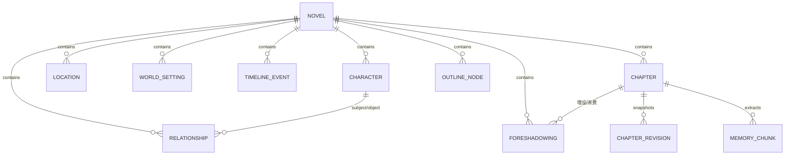

# 灵墨（Lingmo）— 数据模型设计

> **文档状态：基准（Spec）** — 定义全部表结构应有的样子。实际表结构以 `backend/app/infrastructure/models.py` 为准；两者不一致即为缺陷，必须修正其中一边。

Story Bible 是系统唯一事实源。本文定义全部 SQLite 表结构与核心字段语义。所有 `id` 使用 UUID 字符串，`created_at` / `updated_at` 为 UTC 时间戳（ISO 8601）。

当前实际共有 18 张表；以下包括方向 B 和后台自动驾驶后来新增的动作、恢复缓存、任务与事件表。数据库存储 JSON 使用 SQLAlchemy JSON 类型，不维护外部向量数据库。

## 实体关系总览

## 表定义

### novel（作品）

| 字段 | 类型 | 说明 |
|------|------|------|
| id | TEXT PK | UUID |
| title | TEXT | 书名 |
| genre | TEXT | 题材/类型，可自定义 |
| summary | TEXT | 一句话简介 |
| style_anchor | TEXT | 文风锚定基准文本（可选，阶段二用） |
| created_at / updated_at | TEXT | 时间戳 |

### character（人物档案）

| 字段 | 类型 | 说明 |
|------|------|------|
| id | TEXT PK | UUID |
| novel_id | TEXT FK | 所属作品 |
| name | TEXT | 姓名 |
| role | TEXT | 身份/定位（主角/配角/反派/路人） |
| personality | TEXT | 性格 |
| goal | TEXT | 目标/动机 |
| appearance | TEXT | 外貌特征 |
| catchphrase | TEXT | 口头禅 |
| pov | TEXT | POV 视角（是否可做主视角） |
| frequency | TEXT | 登场频率调度 |
| known_info | TEXT | 已知信息（一致性检查用：此人「知道什么」） |
| extras | TEXT JSON | 扩展字段（血型/阵营/能力等自由键值） |
| created_at / updated_at | TEXT | 时间戳 |

### location（地点）

| 字段 | 类型 | 说明 |
|------|------|------|
| id | TEXT PK | UUID |
| novel_id | TEXT FK | 所属作品 |
| name | TEXT | 名称 |
| level | TEXT | 层级（世界/大陆/城市/建筑等） |
| parent_id | TEXT | 上级地点（可空，构成层级） |
| description | TEXT | 描述 |
| created_at / updated_at | TEXT | 时间戳 |

### world_setting（世界观条目）

| 字段 | 类型 | 说明 |
|------|------|------|
| id | TEXT PK | UUID |
| novel_id | TEXT FK | 所属作品 |
| name | TEXT | 条目名 |
| category | TEXT | 类型（法则/修炼体系/势力/地理/文化等） |
| description | TEXT | 说明 |
| tags | TEXT JSON | 三元组标签 `["主体","关系","客体"]` 数组，用于结构化检索 |
| created_at / updated_at | TEXT | 时间戳 |

### timeline_event（时间线事件）

| 字段 | 类型 | 说明 |
|------|------|------|
| id | TEXT PK | UUID |
| novel_id | TEXT FK | 所属作品 |
| title | TEXT | 事件名 |
| time_point | TEXT | 时间点（可相对，如「第3章」「开篇前10年」） |
| participants | TEXT JSON | 参与人物 id 数组 |
| cause_id | TEXT | 因果前序事件 id（可空） |
| description | TEXT | 描述 |
| created_at / updated_at | TEXT | 时间戳 |

### foreshadowing（伏笔注册表）

| 字段 | 类型 | 说明 |
|------|------|------|
| id | TEXT PK | UUID |
| novel_id | TEXT FK | 所属作品 |
| content | TEXT | 伏笔内容 |
| status | TEXT | `planted`（已埋）/ `suspended`（已悬置）/ `consumed`（已消费） |
| related_characters | TEXT JSON | 关联人物 id 数组 |
| planted_chapter_id | TEXT | 埋设章节（可空） |
| consumed_chapter_id | TEXT | 消费章节（可空） |
| created_at / updated_at | TEXT | 时间戳 |

### relationship（关系）

| 字段 | 类型 | 说明 |
|------|------|------|
| id | TEXT PK | UUID |
| novel_id | TEXT FK | 所属作品 |
| subject_id | TEXT | 主体实体 id（人物或势力） |
| object_id | TEXT | 客体实体 id |
| relation_type | TEXT | 关系类型（师徒/敌对/同盟/亲属/爱慕…可自定义） |
| note | TEXT | 备注 |
| created_at / updated_at | TEXT | 时间戳 |

### outline_node（大纲节点）

| 字段 | 类型 | 说明 |
|------|------|------|
| id | TEXT PK | UUID |
| novel_id | TEXT FK | 所属作品 |
| level | TEXT | `volume`（卷）/ `act`（幕）/ `chapter`（章） |
| title | TEXT | 标题 |
| summary | TEXT | 概要 |
| parent_id | TEXT | 父节点 id（可空） |
| sort_order | INTEGER | 同级排序 |
| created_at / updated_at | TEXT | 时间戳 |

### chapter（章节）

| 字段 | 类型 | 说明 |
|------|------|------|
| id | TEXT PK | UUID |
| novel_id | TEXT FK | 所属作品 |
| outline_node_id | TEXT | 对应大纲节点（可空） |
| seq | INTEGER | 章节序号 |
| title | TEXT | 标题 |
| content | TEXT | 正文 |
| status | TEXT | `draft`（草稿）/ `finalized`（定稿） |
| summary | TEXT | 章级摘要（生成后提炼，供摘要链用） |
| tension_score | REAL | 张力评分 0–10（可空） |
| drift_score | REAL | 文风漂移分 0–1（可空，阶段七新增；由 `db.py` 的 `_ensure_columns` 幂等补列） |
| directive | TEXT | 本章的章前指令（可空） |
| created_at / updated_at | TEXT | 时间戳 |

### chapter_revision（章节历史版本，阶段八）

覆盖章节作者字段前保存旧状态；恢复时只回写标题、正文和章前指令，随后章节退回草稿并清空派生数据。

| 字段 | 类型 | 说明 |
|------|------|------|
| id | TEXT PK | UUID |
| novel_id | TEXT FK | 所属作品 |
| chapter_id | TEXT | 所属章节 ID；删除章节或作品时由仓储清理 |
| revision_no | INTEGER | 同章递增版本号，和 `chapter_id` 组成唯一约束 |
| source | TEXT | `manual_save` / `rewrite_apply` / `continue` / `rewrite` / `restore` |
| title / content / directive | TEXT | 覆盖前的作者字段 |
| status / summary | TEXT | 快照时的审阅状态，不在恢复时回写 |
| tension_score / drift_score | REAL NULL | 快照时质量分，仅供审阅 |
| word_count | INTEGER | 去除所有空白后的字符数 |
| created_at | TEXT | 创建时间 |

索引：`chapter_revision(novel_id, chapter_id, revision_no)`。

### memory_chunk（记忆/知识块，配向量索引）

正文切片与三元组的统一存储。向量不存外部向量库，直接以 JSON 数组落在本表 `vector` 列，检索由 `infrastructure/vector/` 用 NumPy 算余弦相似度完成（零新增重依赖，明确不用 chromadb）。

| 字段 | 类型 | 说明 |
|------|------|------|
| id | TEXT PK | UUID |
| novel_id | TEXT FK | 所属作品 |
| kind | TEXT | `chapter_slice`（正文切片）/ `triple`（三元组）/ `setting`（当前设定索引） |
| source_chapter_id | TEXT | 来源章节（可空） |
| text | TEXT | 文本内容或三元组 `主体|关系|客体` |
| embedding_id | TEXT | 向量 id |
| vector | TEXT JSON | 嵌入向量（`bge-small-zh-v1.5`，512 维浮点数组） |
| created_at / updated_at | TEXT | 时间戳 |

`setting` 以 `embedding_id=实体 UUID` 标识当前设定，变更时替换或失效旧块。`chapter_slice` 重复定稿时原子替换该作品该章的切片，避免旧稿与重复记忆被召回。

### injection（构思注入记录）

记录每次构思注入的来源与结果，便于追溯。

| 字段 | 类型 | 说明 |
|------|------|------|
| id | TEXT PK | UUID |
| novel_id | TEXT FK | 所属作品 |
| channel | TEXT | `card`（设定卡）/ `directive`（章前指令）/ `chat`（对话式） |
| raw_text | TEXT | 原始输入 |
| parsed_intent | TEXT JSON | 意图识别结果（阶段四，可空） |
| applied_changes | TEXT JSON | 实际应用的变更集（影响的实体 id 列表） |
| created_at | TEXT | 时间戳 |

### conversation（会话，阶段六）

全局对话的容器。`novel_id` 可空：为空即「无作品的全局会话」，非空即绑定该作品、装配上下文时携带其 Story Bible 信息。

| 字段 | 类型 | 说明 |
|------|------|------|
| id | TEXT PK | UUID |
| novel_id | TEXT FK | 所属作品，**可空**（空 = 全局会话） |
| title | TEXT | 会话标题 |
| created_at / updated_at | TEXT | 时间戳 |

### message（消息，阶段六）

| 字段 | 类型 | 说明 |
|------|------|------|
| id | TEXT PK | UUID |
| conversation_id | TEXT FK | 所属会话 |
| role | TEXT | `user` / `assistant` |
| content | TEXT | 消息正文 |
| meta | TEXT JSON | 附加信息（可空）：落地标记、关联实体等 |
| created_at | TEXT | 时间戳 |

### chat_action（聊天确认动作，方向 B）

| 字段 | 类型 | 说明 |
|------|------|------|
| id / message_id / novel_id | TEXT | 动作 ID、来源消息、来源作品；消息与作品列有外键 |
| action_type | TEXT | `settings` / `outline` / `chapter` |
| status | TEXT | 动作状态 |
| result_id / result_summary | TEXT / JSON | 结果 ID 与摘要，供刷新后回显 |
| created_at | TEXT | 创建时间 |

唯一约束 `(message_id, action_type)`；实体写入与动作完成同事务，重试返回已有结果，不重复创建。

### autopilot_draft（自动驾驶半稿恢复缓存）

| 字段 | 类型 | 说明 |
|------|------|------|
| id / novel_id / node_id | TEXT | 草稿 UUID、作品、来源大纲节点 |
| title / content / reason | TEXT | 标题、已收到片段、失败或未确认原因 |
| attempt / revision | INTEGER | 尝试次数与乐观并发版本，均至少为 1 |
| state | TEXT | `active` / `failed` / `unconfirmed` |
| deleted | BOOLEAN | 删除墓碑；删除后清空正文，防止迟到保存复活 |
| created_at / updated_at | TEXT | 时间戳 |

索引 `(novel_id, deleted, created_at)`。该缓存不属于正式章节或 Story Bible，不因恢复界面而自动生成或定稿。

### autopilot_task（后台任务与快照）

| 字段 | 类型 | 说明 |
|------|------|------|
| id / novel_id | TEXT | 任务 ID 与所属作品 |
| status | TEXT | `starting` / `running` / `paused` / `completed` / `incomplete` / `stopped` / `interrupted` |
| last_event_id | INTEGER | 已提交的最大事件游标 |
| snapshot_json | JSON | 公开状态、统计、告警、活动半稿及冻结篇幅范围等恢复资料 |
| finished_at | TEXT NULL | 终态时间 |
| created_at / updated_at | TEXT | 时间戳 |

SQLite 部分唯一索引限制同作品最多一个 `starting/running/paused` 活动任务。进程重启保留中断状态和资料，不隐式继续调用模型。

### autopilot_task_event（可重放事件）

| 字段 | 类型 | 说明 |
|------|------|------|
| id / task_id / novel_id | TEXT | 事件 ID、来源任务、所属作品 |
| event_id | INTEGER | 任务内单调游标 |
| data_json | JSON | 公开 SSE 事件内容 |
| created_at | TEXT | 创建时间 |

唯一约束 `(task_id, event_id)`，索引 `(novel_id, task_id, event_id)`；订阅者按游标恢复，正文片段不重复追加。

## 关键设计决策

1. **扩展字段用 `extras`/`tags` 等 TEXT JSON**：人物、世界观等实体的字段无法穷尽，灵活键值避免频繁改表。
2. **`known_info` 放人物表**：一致性检查最常出错的是「角色知道了不该知道的信息」，把「已知信息」作为一等字段，比事后 LLM 判断更可靠。
3. **伏笔用状态机 + 关联章节**：`planted → suspended → consumed`，配合章节 id，可自动算出「哪些伏笔埋了没闭合」。
4. **摘要链用 `chapter.summary`**：每章定稿后提炼一句摘要，跨章上下文装配时按序拼接，成本远低于塞全文。
5. **关系单独成表**：人物/势力关系是知识图谱的边，独立建模才能支撑图谱可视化与「关系一致性」检查。
6. **大纲与章节分离**：大纲是「计划」，章节是「产物」，解耦后自动驾驶才能按大纲推进、产物另存。
7. **会话的 `novel_id` 可空**：让「构思期还没有作品」和「作品内对话」共用一张表与一套 API，避免两套会话模型。
8. **向量与元数据同表**：`memory_chunk.vector` 直接存 JSON 数组，不引外部向量库——单机单用户的数据量用 NumPy 全量算余弦相似度足够，省掉一个重依赖与一层运维。

## 索引建议

- `character(novel_id)`、`location(novel_id)`、`world_setting(novel_id)`、`timeline_event(novel_id)`、`foreshadowing(novel_id, status)`、`relationship(novel_id)`、`chapter(novel_id, seq)`、`outline_node(novel_id, parent_id)`、`conversation(novel_id)`、`message(conversation_id)`。
- `foreshadowing(status)` 用于快速列出未闭合伏笔。
