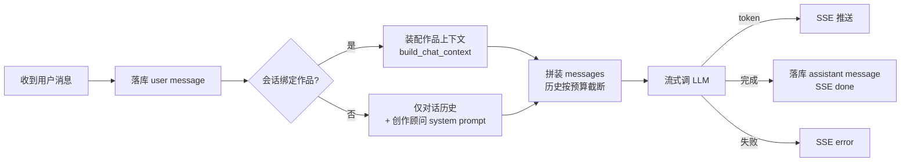

# 灵墨（Lingmo）— 阶段六：全局对话系统

> **文档状态：已收口** — 阶段六已实现并验收（commit `fc18d6f`）。本文描述当时的设计与验收标准，除「已知偏差」外视为已落地；新发现的实现偏差不得靠改本文掩盖。

对话从「作品内的一个 tab」升级为**全局一等公民**：像 ChatGPT 一样随时可聊，像 Projects 一样按作品归档。本文是阶段六的完整设计，前置依赖为阶段一～五（全部已完成）。

## 1. 背景与目标

**背景**：现有「对话共创」是作品下的一个 tab，必须先建作品才能用。但创作的前半程（构思期）恰恰没有作品——作者需要先和 AI 讨论设定、故事走向、人物设计，聊出方向再建作品。

**目标**：

1. 对话**始终可用**：无作品时可自由开聊（构思期），有作品时自动携带该作品设定上下文（创作期）。
2. 会话**按作品归档**：作品即「任务列表」，作品下的会话挂在作品分组里；全局会话独立成区。
3. 讨论**显式落地**：默认只讨论不动数据；点「应用到作品」才把结论写进 Story Bible。
4. **一条通路**：移除旧「对话共创」tab，其能力并入聊天界面，不留两个对话入口。

## 2. 产品形态（已确认的决策）

### 2.1 页面结构

顶层从「单页 + tab」改为**双视图**：

- **对话页（默认视图）**：左侧两区侧栏 + 右侧聊天窗口。
  - 侧栏上半区「全局对话」：新对话按钮 + 全局会话列表（未绑定作品，构思期自由聊）。
  - 侧栏下半区「作品」：作品列表（即任务列表），每部作品可折叠展开其会话列表；底部「+ 新建作品」。
  - 点击会话 → 右侧聊天窗口（消息流 + 输入框）。
  - 点击作品名旁的「进入工作台」→ 切到该作品的工作台视图。
- **工作台视图**：现有 tab（设定面板 / 写作 / 大纲 / 自动驾驶 / 知识图谱）原样保留，**移除「对话共创」tab**；顶部保留作品下拉便于直接切换。

不引入 vue-router，用 App.vue 内的视图 ref 切换（单用户本地应用，无 URL 路由需求）。

### 2.2 关键决策记录

| 决策 | 结论 |
|------|------|
| 会话归属 | **创建时固定**：全局（`novel_id=null`）或绑定某作品；不做会话内切换 |
| 会话移动 | 支持「转为作品」（全局会话一键建作品并入组）与「移动到作品」（仅全局→已有作品） |
| 落地时机 | **显式触发**：仅用户点「应用到作品」时调用构思注入；聊天本身零副作用 |
| 提炼成设定 | **二期**：从对话自动提炼结构化设定草稿，本期不做（转为作品流程保持简单） |
| 落地动作范围 | 首版仅「应用到作品」；「生成大纲 / 写章节」通过进入工作台对应 tab 完成 |
| 依赖 | **零新增依赖**，沿用现有前后端栈（符合分阶段依赖纪律） |

## 3. 数据模型（新增两张表）

### conversation（会话）

| 字段 | 类型 | 说明 |
|------|------|------|
| id | TEXT PK | UUID |
| novel_id | TEXT FK，可空 | 所属作品；NULL = 全局会话 |
| title | TEXT | 会话标题；默认取首条用户消息前 20 字，可重命名 |
| created_at / updated_at | TEXT | 时间戳 |

索引：`conversation(novel_id)`、`conversation(updated_at)`（侧栏按最近活跃排序）。

### message（消息）

| 字段 | 类型 | 说明 |
|------|------|------|
| id | TEXT PK | UUID |
| conversation_id | TEXT FK | 所属会话 |
| role | TEXT | `user` / `assistant` |
| content | TEXT | 消息正文 |
| meta | TEXT JSON | 附加数据：落地动作记录（applied 变更摘要）、错误信息等 |
| created_at | TEXT | 时间戳 |

设计要点：

1. **message 不存 novel_id**——会话归属创建时固定，消息跟随会话，避免冗余。
2. **删除级联**：`novel` 删除时级联删除其 `conversation` 及其下 `message`（并入现有 11 表级联链）；全局会话不受影响。删除会话级联删其消息。
3. `injection` 表不变：聊天里的落地动作走现有 `apply_injections(channel="chat")`，自动留痕。

## 4. 后端设计

### 4.1 API（新增 `interfaces/api/v1/conversations.py`）

| 方法 | 路径 | 说明 |
|------|------|------|
| GET | `/conversations` | 列出全部会话（含全局与作品会话，带 novel_id，前端自行分组）；按 updated_at 倒序 |
| POST | `/conversations` | 新建会话 `{novel_id?: string \| null}`，返回会话 |
| PATCH | `/conversations/{id}` | 重命名 `{title}` 或移动 `{novel_id}`（转作品/移动到作品用） |
| DELETE | `/conversations/{id}` | 删除会话（级联删消息） |
| GET | `/conversations/{id}/messages` | 拉取该会话全部消息（按 created_at 升序，单用户量级无需分页） |
| POST | `/conversations/{id}/messages` | 发送消息 `{content}`，**SSE 流式**返回回复 |
| POST | `/conversations/{id}/promote` | 转为作品 `{title, genre?, summary?}`：建 novel + 会话归组，返回新作品 |

### 4.2 SSE 协议（对齐现有 streamSSE 模式）

`POST /conversations/{id}/messages` 逐事件推送：

```
data: {"type": "token", "content": "…"}        # 增量 token
data: {"type": "done", "user_message_id": "…", "assistant_message_id": "…", "title": "…"}   # 完成：两条消息已落库；title 为自动更新后的会话标题
data: {"type": "error", "detail": "…"}          # 失败：未落库 assistant 消息
```

失败语义：user 消息已落库、assistant 不落库或落库 `meta={"error": …}`，前端提示可重发；不产生半截脏消息。

### 4.3 用例：`application/chat.py`

```
reply_conversation(db, conversation_id, content) -> SSE 生成器
```

流程：



上下文装配规则：

- **历史消息**：最近 20 条（按角色交替拼接），超出截断。
- **绑定作品时**（新增轻量装配 `build_chat_context`，区别于章节生成的全量 `build_context`，控制 token 成本）：
  - 人物一行卡：`姓名（定位）— 性格 — 目标`；
  - 世界观条目：`条目名 [类别] — 一句话说明`；
  - 大纲：卷/章标题列表（未生成章节标注）；
  - 最近 3 章摘要链。
- **全局会话时**：仅历史 + system prompt（灵墨创作顾问人设：帮作者打磨设定/走向/人物，中文网络小说语境）。
- 优先级（超预算时从后往前丢弃）：system prompt > 最近历史 > 人物卡 > 世界观 > 大纲 > 摘要链。

### 4.4 落地动作（复用阶段四，零改动）

聊天窗口中每条 assistant 消息 hover 出现「应用到作品」：

1. 该消息文本作为构思 → 调现有 `POST /novels/{novel_id}/ideas/chat`（`inject_idea` 意图解析 + 目标匹配）；
2. 前端展示变更建议卡片（迁移自现 IdeaPanel 的卡片交互，可编辑 JSON）；
3. 确认 → 调现有 `POST /novels/{novel_id}/ideas/apply`（应用 + 大纲重规划 + 一致性检查 + injection 留痕）；
4. 成功后在消息 `meta` 记录落地摘要（`{"applied": [...], "at": "…"}`），气泡上显示已落地标记。

约束：仅绑定作品的会话可用；全局会话该按钮置灰并提示「先转为作品」。

### 4.5 转为作品（promote）

`POST /conversations/{id}/promote`：创建 novel（书名默认取会话标题，可改）→ 更新 `conversation.novel_id` → 返回新作品。前端随即刷新侧栏（会话移入该作品分组）。**不**自动从对话提炼设定（二期增强）。

## 5. 前端设计

### 5.1 组件结构

```
App.vue                     # 视图切换：chat | workbench
├── ChatView.vue            # 对话页（默认视图）
│   ├── ConversationSidebar.vue   # 两区侧栏：全局会话 + 作品分组会话树
│   ├── ChatWindow.vue            # 消息流 + 输入框 + 会话操作（重命名/转为作品/移动/删除）
│   ├── MessageBubble.vue         # 气泡；assistant 气泡带「应用到作品」
│   └── ApplySuggestionCard.vue   # 变更建议卡片（自 IdeaPanel 迁移）
└── WorkbenchView.vue       # 工作台：现 App.vue 主体迁移（移除 idea tab）
```

### 5.2 交互要点

- **新对话**：侧栏顶部按钮 → 立即创建全局会话（空标题显示「新对话」，首条消息后自动命名）。
- **作品下开聊**：作品分组内「+ 新会话」→ 创建绑定该作品的会话。
- **转为作品**：全局会话聊天窗头部按钮 → 弹窗填书名/题材/简介（书名预填会话标题）→ 成功后会话移入作品分组。
- **移动到作品**：全局会话头部「移动到作品」→ 选目标作品。
- **进入工作台**：作品分组头部的按钮 → 切换到工作台视图并选中该作品；工作台内可一键切回对话页。
- **流式渲染**：复用 `api.ts` 的 `streamSSE`；发送后立即渲染 user 气泡 + assistant 占位气泡逐 token 填充。
- **应用建议卡片**：在聊天流内联展开（非弹窗），确认/取消后收起并标记结果。

## 6. 复用与改动清单

| 现有模块 | 处理 |
|----------|------|
| `application/inject_idea.py`（inject_idea / apply_injections） | **原样复用**，作为「应用到作品」动作引擎 |
| `application/context.py`（build_context） | 保留（章节生成用）；新增轻量 `build_chat_context` |
| `infrastructure/ai/llm_provider.py` | 复用流式调用 |
| novel 删除级联（11 表） | 扩为 13 表（+conversation、message） |
| `frontend/src/api.ts` streamSSE | 复用 |
| `IdeaPanel.vue` | **淘汰**：卡片交互迁移到 `ApplySuggestionCard.vue`，tab 移除 |
| App.vue 顶部 tabs | 迁入 `WorkbenchView.vue`，去掉「对话共创」tab |
| 其余面板（设定/写作/大纲/自动驾驶/图谱） | 原样迁移，不改逻辑 |

## 7. 任务分解（施工顺序）

1. **数据层**：models.py 新增 `Conversation`/`Message` + 建表；`ConversationRepo`（list/create/update/delete + 消息读写）；novel 级联删除扩展。
2. **用例层**：`application/chat.py`（`reply_conversation` + `build_chat_context` + 顾问 system prompt，prompt 进 `prompts.py` 集中管理）。
3. **接口层**：conversations 路由 + schemas + router 注册 + SSE 事件协议实现。
4. **前端骨架**：App.vue 双视图切换；WorkbenchView 承接现有 tabs。
5. **前端侧栏**：ConversationSidebar 两区列表 + 新建/重命名/删除/移动/转为作品。
6. **前端聊天窗**：ChatWindow + MessageBubble + 流式渲染 + 消息历史加载。
7. **前端落地动作**：应用到作品按钮 + ApplySuggestionCard 内联卡片 + meta 落地标记；移除旧「对话共创」tab。
8. **测试**：会话 CRUD、消息流式落库（mock LLM）、转为作品、移动到作品、级联删除、全局会话禁用落地按钮、既有 33 条测试不回归。

## 8. 验收标准

1. 不选任何作品，新建全局会话发消息，得到流式中文回复；重启服务后会话与消息仍在。
2. 在某作品下新建会话，问「林越现在知道自己的身世吗」，回复体现该作品 Story Bible 中的人物已知信息（作品上下文生效）。
3. 在 assistant 回复上点「应用到作品」→ 出现可编辑的变更建议卡片 → 确认后设定面板出现对应新设定，`injection` 表有 `chat` 通道记录，消息气泡显示已落地标记。
4. 全局会话聊出方向 → 点「转为作品」填书名 → 会话移入新作品分组，继续对话自动携带新作品上下文。
5. 「移动到作品」后，会话出现在目标作品分组下且上下文切换为该作品。
6. 工作台视图 5 个 tab 功能不回归；「对话共创」tab 不再存在。
7. 删除作品 → 其下会话与消息一并删除，全局会话不受影响；删除会话 → 其消息一并删除。
8. 新增测试与既有全部测试通过。

## 9. 风险与边界

- **每轮聊天的 token 成本**：用轻量 `build_chat_context` 而非全量 `build_context`，人物/世界观只给一行卡；历史截断 20 条。
- **SSE 断连**：assistant 未落库则前端重发即可（user 消息幂等由前端防重复点击兜底）；已落库则刷新可见。
- **并发写**：沿用单写者假设（单用户本地应用），不做消息级锁。
- **标题自动命名**：仅首条消息时生成一次，此后重命名不覆盖。

## 10. 已知偏差（阶段六收口后新增发现，尚未裁决）

本章记录实现与本设计不一致、但**尚未决定改代码还是改文档**的点。裁决前不得据本章自行改动，以免与阶段七的改动互相覆盖。

1. **`injection` 留痕在 UI 路径上不触发** — 本设计第 8 章验收第 3 条要求：确认落地后 `injection` 表出现 `chat` 通道记录。现状：后端 `inject_idea.py` 的 `apply_injections(..., raw_text: str = "", channel: str = "chat")` 在 `raw_text` 非空时才写留痕（`if raw_text:`），而前端 `frontend/src/api.ts` 的 `ideaApply` 只发 `{ suggestions }`、从不发 `raw_text`，因此该条件恒为假，留痕不会写入。后端能力完整、前端少传一个字段，属接口契约未对齐，而非后端缺陷。
2. **大纲归属字段被丢弃** — `backend/app/interfaces/api/v1/chapters.py` 处理章节更新时忽略了 `payload.outline_node_id`，前端传来的大纲节点绑定不会落库。涉及阶段二的既有能力，同样待裁决。

