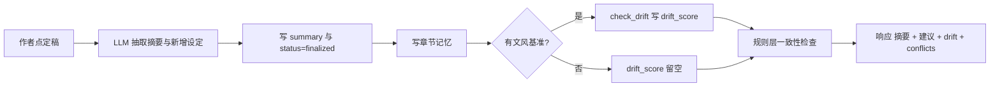

# 灵墨（Lingmo）— 阶段七：质量治理与一致性深化

阶段七补完 F7 质量治理：把已经写好的张力评分、文风漂移、规则一致性三条线接到前端入口，再补上套路表达扫描与伏笔追踪。本文是阶段七的完整设计，前置依赖为阶段一～六（全部已完成）。

## 1. 背景与目标

**现状**

| F7 子功能 | 代码核对结果 |
|-----------|--------------|
| 张力评分 | 完整。`score_tension` 打分写入 `chapter.tension_score`，自动驾驶面板有历史曲线 |
| 文风漂移 | 后端逻辑在（`check_drift` 比对 `novel.style_anchor`，阈值 0.6），前端没有任何设置 `style_anchor` 的入口，实际未启用 |
| 一致性检查 | 只有规则层三条（伏笔状态、人物已知信息、时间线先后），模块注释写明 LLM 语义判断后置 |
| 伏笔追踪 | 只有 CRUD。`planted_chapter_id` / `consumed_chapter_id` / `status` 字段齐备，但落库伏笔时埋设章节不写入 |
| 去 AI 味 | 只有 `rewrite_passage` 的一个改写意图，没有扫描，也看不到命中密度 |

**目标**

1. 去 AI 味可量化：扫描章节正文，标出套路表达的位置与密度，选中片段可先看改写效果再决定落库。
2. 文风漂移可用：作者选定风格基准，每章定稿时自动比对记分，全书漂移曲线可查。
3. 伏笔可见：按状态分组展示，标注埋设章节与悬置章数，长期未闭合的排前。
4. 一致性分两层：规则层零成本兜底，LLM 语义层按需触发，补规则层漏掉的人设与时间线冲突。

## 2. 决策记录

| 决策 | 结论 |
|------|------|
| D1 词库位置 | 代码内置模块（`application/cliche.py`），四类表达，约 100 条；不做词库编辑界面，不建表 |
| D2 改写粒度与落库时机 | 段落级；复用 `rewrite_passage(intent="去AI味")`；先预览，作者点「应用」才落库；不做全文一键改写 |
| D3 文风锚定入口 | 两个入口：从选中章节取前 800 字作基准 + 手动编辑文本框；漂移检测从自动驾驶扩展到手工定稿 |
| D4 语义复核成本模型 | 定稿默认只跑规则层（零额外成本）；「深度检查」按钮才触发 LLM 语义复核，按约 800 字切块，返回冲突与判定依据 |
| D5 结果持久化 | 套路扫描与语义复核结果即算即用，不落库；文风漂移分要撑起历史曲线，落到新增列 `chapter.drift_score` |
| D6 长期未闭合阈值 | 悬置章数 ≥ 10 章，或 ≥ 已写章节数的 30%，先到者为准 |

D2 需要在现有改写端点上加一个 `preview` 参数。`rewrite_passage` 现在是生成完直接覆盖正文，没有确认环节；加参数后默认行为不变，只有预览调用走不落库分支。

D5 只对漂移分破例落库，因为曲线要跨会话可查（验收标准里的「历史曲线可查」）。一次 LLM 调用的成本换来免重复计分，比每次打开面板全量重算划算。套路扫描是纯字符串匹配，语义复核是即时判断，两者都没有留存价值。

## 3. 数据模型

不新增表。`foreshadowing` 的埋设与消费章节字段、`novel.style_anchor` 都已存在，阶段七补的是写入与读取。唯一结构变更是给 `chapter` 加一列，与已有的 `tension_score` 对称：

| 表 | 变更 | 说明 |
|----|------|------|
| chapter | 新增 `drift_score` FLOAT NULL | 定稿时与文风基准的相似度 0–1；无基准或未定稿时为 NULL |

`init_db` 目前只做 `Base.metadata.create_all`，它不会给已存在的表补列。新增一个幂等的 `_ensure_columns(engine)`：读 `PRAGMA table_info(chapter)`，缺 `drift_score` 就执行 `ALTER TABLE chapter ADD COLUMN drift_score FLOAT`，在 `init_db` 里调一次。`db.py` 的注释本就写了「阶段一用 create_all，后续引入迁移工具后替换」，这一步等迁移工具落地时整体删掉。

伏笔埋设章节的补齐：`apply_suggestions` 落库伏笔时写入 `planted_chapter_id`，路由已经拿到 `chapter_id`，透传即可。历史数据的该字段留空，追踪面板提供「指定埋设章节」快捷操作，走现有 `PUT /foreshadowings/{id}`，不猜测。

## 4. 后端设计

### 4.1 API

新建 `interfaces/api/v1/quality.py`，prefix `/novels/{novel_id}`。路径都挂在 `/quality` 下，避开设定实体通用 CRUD 路由的 `/{id}` 匹配。

| 方法 | 路径 | 说明 |
|------|------|------|
| POST | `/quality/cliche` | 扫描套路表达，body `{content}`，返回命中项与密度 |
| GET | `/quality/curve` | 全书质量曲线：每章 `seq` / `title` / `status` / `tension_score` / `drift_score`，附 `anchor_set` 与 `drift_threshold` |
| GET | `/quality/foreshadowings` | 伏笔追踪聚合，按状态分组 |
| POST | `/consistency/deep` | 语义复核，并入现有 `consistency.py` 路由，body `{content}` |

现有端点的改动全是加法，默认行为不变：

| 端点 | 改动 |
|------|------|
| `POST /chapters/{id}/rewrite` | body 加 `preview: bool = false`；为 true 时流式返回改写结果但不写库，`done` 事件带 `preview: true` 与拼好的整章内容 |
| `POST /chapters/{id}/settle` | 定稿后比对文风基准并写 `drift_score`，响应加 `drift` 与规则层 `conflicts` |
| `PUT /novels/{id}` | 不改，`style_anchor` 已可写 |

### 4.2 去 AI 味扫描

新建 `application/cliche.py`，纯字符串匹配，不调 LLM。词库按四类组织：

```python
CLICHE_TERMS: dict[str, list[str]] = {
    "万能副词": [
        "不禁", "仿佛", "竟然", "顿时", "瞬间", "缓缓", "微微", "淡淡", "默默", "轻轻",
        "深深", "不由自主", "情不自禁", "深吸一口气", "心底一沉", "说到底", "不由得",
    ],
    "套路动作": [
        "嘴角勾起", "勾唇一笑", "眉头微皱", "瞳孔骤缩", "倒吸一口凉气", "心中一凛",
        "心头一颤", "脸色一变", "眼神一暗", "眼中闪过一丝", "攥紧拳头", "指节泛白",
        "喉结滚动", "嘴角扬起", "目光灼灼", "呼吸一滞",
    ],
    "面部套话": [
        "嘴角泛起一抹", "眼底深处", "脸上浮现", "神色复杂", "意味深长", "嘴角的弧度",
        "眸色渐深", "神情莫测", "眼中精光一闪", "笑意不达眼底", "面无表情地看着",
    ],
    "心理填充": [
        "五味杂陈", "百感交集", "思绪万千", "心中一紧", "说不出的滋味", "复杂的情绪",
        "不知为何", "莫名地", "与此同时", "总而言之", "值得一提的是",
        "仿佛整个世界都", "一种说不清道不明的",
    ],
}
```

对外只暴露一个函数：

```python
def scan_cliches(content: str) -> dict:
    """返回 {"hits": [...], "total": int, "density": float, "by_category": {...}}"""
```

命中项为 `{term, category, start, end}`，与一致性冲突的字段同形，前端可以直接复用现有高亮渲染。`density` 是每千字命中数，`total / max(len(content), 1) * 1000`，保留一位小数。`by_category` 给四类的命中条数。

重叠处理：按词长倒序扫描，同一区间被长词命中后短词不再重复计数，避免「嘴角勾起」和「嘴角」各记一次。

### 4.3 文风锚定与漂移

`novel.style_anchor` 的字段和写入口都已经在，阶段七补的是谁写、何时比、比完存哪。

- 落库：`PUT /novels/{id}` 传 `style_anchor`。前端两个入口，从章节取基准时取该章正文前 800 字。
- 比对：`check_drift` 原样复用，LLM 输出 0–1 相似度，阈值 `DRIFT_THRESHOLD = 0.6` 不变。
- 触发点从自动驾驶单点扩到两处：自动驾驶每章生成后照旧发 SSE，追加一次写库；`settle_chapter` 手工定稿时新增一次比对并写 `chapter.drift_score`。
- 曲线数据由 `GET /quality/curve` 按 `seq` 升序返回 `drift_score` 非空的章节。

`check_drift` 每次是一次 LLM 调用（`max_tokens=10`）。定稿只比一次；同一章重复定稿会重新计分并覆盖旧值。

### 4.4 一致性检查双层化

规则层原样保留，`application/consistency.py` 的三条规则不动，作为语义层的前置过滤。新增 `deep_check(db, novel_id, content)`：

1. 按空行与段落聚合，切成约 800 字的块。
2. 规则层已命中的块跳过，冲突已经报过，不重复送 LLM。
3. 块内需出现至少一个人物、地点或世界观条目名，否则不可能违反人设或时间线，跳过。
4. 剩余块送 LLM，单次上限 8 块，超出部分在响应里标 `truncated`。
5. 返回 `{conflicts, chunks_checked, chunks_skipped, truncated}`，冲突项形如 `{rule: "semantic", type, excerpt, reason, severity, chunk_index}`。

设定上下文复用 `build_context` 的装配结果，只保留参与比对的实体，控制 token。prompt 进 `prompts.py`：

```python
DEEP_CHECK_SYSTEM = (
    "你是中文小说的一致性审校员。对照给定设定，判断正文是否与人物设定、时间线、"
    "世界观冲突。严格只输出 JSON，不要输出任何其它文字或代码块标记。"
)

DEEP_CHECK_USER = """设定：
{setting}

正文片段：
{chunk}

只返回 JSON：{{"conflicts": [{{"type": "人设|时间线|设定", "excerpt": "冲突原句", "reason": "判定依据", "severity": "high|medium|low"}}]}}
没有冲突返回空数组。
"""
```

结果不落库。定稿流程只跑规则层，`settle_chapter` 响应里带 `conflicts` 字段。

### 4.5 伏笔追踪聚合

已写章节按 `seq` 排序，得到 `seq → chapter` 映射与最大 `seq`（记为 `latest`）。每条伏笔算三个派生值：

- `planted_seq`：`planted_chapter_id` 对应章节的 `seq`；字段为空时为 `null`。
- `suspended_chapters`：已消费时取 `consumed_seq - planted_seq - 1`，未消费时取 `latest - planted_seq`；`planted_seq` 为空时为 `null`。
- `long_pending`：`status` 为 `suspended`，且 `suspended_chapters` 非空，且 `suspended_chapters >= 10` 或 `suspended_chapters >= 0.3 * 已写章节数`。

响应结构：

```json
{
  "groups": {"planted": [], "suspended": [], "consumed": []},
  "latest_seq": 42,
  "chapter_count": 42,
  "long_pending_threshold": {"chapters": 10, "ratio": 0.3}
}
```

组内排序：`suspended` 组先按 `long_pending` 排，再按 `suspended_chapters` 降序；另外两组按 `seq` 升序。`planted_seq` 为空的条目排在各组末尾。阈值随响应下发，前端不写死。

### 4.6 定稿流程



## 5. 前端设计

### 5.1 组件结构

```
WorkbenchView.vue            # tab 从 5 个加到 6 个
├── SettingsPanel.vue        # 加「文风基准」区
├── WritingPanel.vue         # 加套路扫描与深度检查，改写给预览确认
├── ForeshadowingTracking.vue  # 新建，伏笔追踪 tab
└── AutopilotPanel.vue       # 质量曲线加一条漂移线
```

### 5.2 交互要点

- 文风基准（设定面板）：文本框加「从章节取基准」下拉。下拉列出已有章节，选中后把该章正文前 800 字填进文本框，可再手动编辑；保存走 `api.updateNovel(id, { style_anchor })`。未设置时漂移相关 UI 显示一行提示，不隐藏入口。
- 套路扫描（写作面板）：按钮扫当前正文，命中项与一致性冲突共用高亮。`segments` 从二值 `highlighted` 扩成带 `kind` 的分段，冲突一种底色、套路一种底色。面板顶部显示每千字命中数与四类分布。
- 改写预览（写作面板）：选中片段，选意图（默认去 AI 味），调 `/rewrite` 带 `preview: true`，弹出的对比框并列显示原文与改写，点「应用」调 `api.updateChapter` 落库，点「放弃」丢弃。替换仍取首次匹配位置，与现有 `rewrite_passage` 一致。
- 深度检查（写作面板）：规则检查按钮旁新增「深度检查」，按钮带一次模型调用的成本提示。结果单独一列，显示类型、冲突原句、判定依据，点击可滚动定位。
- 伏笔追踪（新 tab）：三个分组列表，条目显示伏笔内容、埋设章节、悬置章数。「长期未闭合」在条目上加标记并置顶；「指定埋设章节」用下拉调 `PUT /foreshadowings/{id}`；「标记已消费」把 `status` 与 `consumed_chapter_id` 写成当前选中章。
- 质量曲线（自动驾驶面板）：现有张力折线加一条漂移序列，按阈值画参考线。初始数据来自 `GET /quality/curve`，自动驾驶运行时由现有 SSE 追加。

## 6. 复用与改动清单

| 现有模块 | 处理 |
|----------|------|
| `application/consistency.py` 三条规则 | 原样保留，作为语义层的前置过滤 |
| `application/auto_pilot.py` `check_drift` / `score_tension` | 原样复用，自动驾驶路径追加写 `drift_score` |
| `application/writing.py` `rewrite_passage` | 加 `preview` 参数，默认行为不变 |
| `application/settle.py` | 定稿后加漂移比对与规则层检查，响应扩字段；落库伏笔时写 `planted_chapter_id` |
| `application/context.py` `build_context` | 复用，为语义复核提供设定上下文 |
| `infrastructure/ai/prompts.py` | 新增 `DEEP_CHECK_SYSTEM` 与 `DEEP_CHECK_USER` |
| `infrastructure/db.py` `init_db` | 加幂等的 `_ensure_columns`，补 `chapter.drift_score` |
| `frontend/src/components/WritingPanel.vue` | `segments` 扩展为带类型的分段，同时渲染冲突与套路命中 |
| `frontend/src/components/AutopilotPanel.vue` | 张力曲线保留，加漂移序列 |
| `frontend/src/components/SettingsPanel.vue` | 加文风基准区，六类实体 CRUD 不动 |
| 导出、对话、记忆检索 | 不动 |

## 7. 任务分解（施工顺序）

1. 数据层：`chapter.drift_score` 列 + `db.py` 幂等补列。`ChapterRepo.update` 已支持按字段名写入，无需改。
2. 去 AI 味：`application/cliche.py` 词库与 `scan_cliches`；`quality.py` 路由与 schemas；`router.py` 注册。
3. 改写预览：`rewrite_passage` 加 `preview`，`RewritePassageRequest` 加字段，写作面板对比框。
4. 文风锚定：设定面板基准区；`settle_chapter` 加漂移比对与写库；`GET /quality/curve`。
5. 伏笔追踪：`apply_suggestions` 写 `planted_chapter_id`；聚合接口；`ForeshadowingTracking.vue` 与工作台新 tab。
6. 语义复核：`prompts.py` 两个 prompt；`deep_check`；`POST /consistency/deep`；写作面板「深度检查」。
7. 质量曲线：自动驾驶面板加漂移序列，接 `GET /quality/curve`。
8. 测试：`test_cliche.py`（命中位置、密度、重叠去重）、`test_quality.py`（曲线、伏笔聚合与阈值）、`test_consistency_deep.py`（切块、跳过逻辑、mock LLM）、`test_writing.py` 补一条预览不落库；既有 39 条不回归。

## 8. 验收标准

1. 对含套路表达的段落，扫描能标出命中位置、每千字密度与四类分布；对选中片段改写并应用后，重扫密度下降。
2. 改写预览阶段正文保持不变，点「应用」才落库，点「放弃」不留痕。
3. 设定面板选定文风基准后，此后定稿的章节有漂移分；`GET /quality/curve` 返回的曲线与各章 `drift_score` 一致。
4. 伏笔面板按「已埋 / 已悬置 / 已消费」分组正确，埋设章节与悬置章数计算正确，长期未闭合项置顶。
5. 构造违反人设或时间线的段落（角色说出自己「不知道」的信息、因果事件顺序倒置），规则层漏掉时语义层能检出，并给出判定依据。
6. 定稿只触发一次模型调用（设定抽取），语义复核不进定稿主流程；深度检查遵守 8 块上限并在截断时如实标记。
7. 不新增依赖；既有 39 条测试与新增测试全部通过。

## 9. 风险与边界

- 词库误报：「缓缓」「轻轻」一类高频词在特定文风与对话里是正常用法。命中只作提示，不触发自动改写，也不折算成评分，密度高低由作者自己判断。
- 相似度波动：`check_drift` 是单次采样结果，同一章重复定稿可能得到不同分数。曲线看趋势不追精度，温度已固定 0.2。
- 语义复核成本：受 8 块上限与实体名过滤两道约束，一次深度检查的块数是可控的，且不进入定稿主流程。
- 新增列的兼容性：`create_all` 不补列，靠 `_ensure_columns` 兜底。若改表失败，曲线接口把 `drift_score` 视为空值，其余功能不受影响。
- 伏笔历史数据：`planted_chapter_id` 为空的老数据算不出悬置章数，面板给「指定埋设章节」让作者补齐，不做时间戳推断。
- 阈值取值：10 章与 30% 是经验值，随接口响应下发，后续调整只改后端常量，前端不动。
